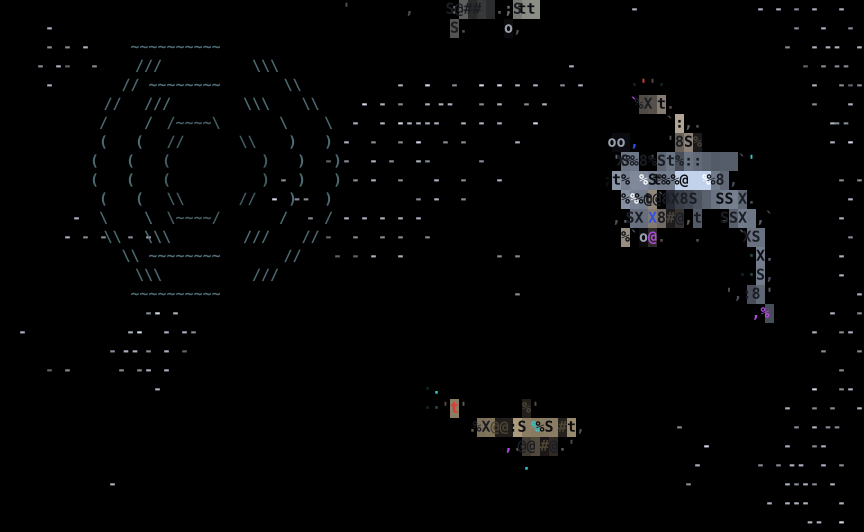

# sharks

**English** | [繁體中文](README.zh-TW.md)

ASCII sharks hunting schools of fish in your terminal, in 24-bit colour. A small (~400 KB), dependency-free Rust port of [stackedlol/ascii-sharks](https://github.com/stackedlol/ascii-sharks), with mouse interaction.

<p align="center">
  
</p>

<sub>A real frame from the renderer, exported to SVG: a great hammerhead (right), a tiger shark (bottom) and a click ripple (left).</sub>

## Features

- **Eight shark species** with their own outlines, fins and markings: hammerheads, tiger, mako, thresher, nurse, zebra and a classic requiem shark.
- **Different every run.** A random mix of species by default, each shark its own size. `--seed` repeats a scene.
- **Living fish schools.** Hundreds of fish school as boids. Alarm spreads through a school, and fleeing fish break sideways around a shark's path. Sharks pick off stragglers, and eaten fish come back later as new schools.
- **Play with it.** Fish flee the pointer. Hover a shark to see its name. Click (or press space) for a ripple that scatters the fish and turns the sharks away. Right-click (or press `f`) to drop a ball of sardines, and watch the sharks come for it.
- **A clock** in seven ASCII-art styles, and room for a line of your own text.
- **Rain**, a **calm** mode without shimmer, a **still** mode that uses no CPU between clock ticks, and **print** for shell greetings.
- **Any terminal.** 24-bit, 256, 16 colours or none (`NO_COLOR` is honoured); ASCII-only glyphs if you need them; East Asian wide-glyph terminals are detected.
- **Light on resources.** About 2 MB of memory, and 5–10% of one CPU core at 30 fps (3–4% at 10 fps).

## Install

### Homebrew (macOS, Linux)

```sh
brew install anson1eechun/tap/sharks
```

### npm

```sh
npm install -g ascii-sharks-term
# or run it without installing:
npx ascii-sharks-term
```

The package ships prebuilt native binaries. A tiny shell launcher `exec`s the right one, so no Node.js process keeps running behind it.

### Cargo

```sh
cargo install --locked --git https://github.com/anson1eechun/ascii-sharks-term sharks
```

### Prebuilt binaries

Download a `.tar.gz` for your platform from [Releases](https://github.com/anson1eechun/ascii-sharks-term/releases) and put `sharks` on your `PATH`. On macOS, a binary downloaded through a browser is quarantined, so clear that once with `xattr -d com.apple.quarantine sharks`.

**Platforms:** macOS (Apple Silicon and Intel) and Linux (x86_64 and arm64; static musl builds). On Windows, use WSL.

## Usage

```sh
sharks                                 # four random kinds of shark
sharks -n 8 --rain                     # eight sharks, in the rain
sharks -k greathammer,tiger,mako       # pick the kinds yourself (sharks -l lists them)
sharks --clock                         # a clock in the middle of the sea
sharks --clock=lcd --seconds -m "Focus" # another style, seconds, and a line of text
sharks --still --clock=big             # a desk clock that sleeps between minutes
sharks --print --clock=dots            # print one frame, e.g. from your shell's rc file
sharks -S                              # screensaver: any key quits
```

| Scene | |
|---|---|
| `-k, --sharks <kind,...>` | Which sharks to show, such as `tiger,mako,zebra`. You can repeat a kind. |
| `-n, --count <n>` | How many random sharks, 1–12 (default 4). Ignored with `-k`. |
| `--fish <n>` | How many fish, 1–1000 (default: by window size). |
| `--seed <n>` | Repeat the same scene. |
| `--speed <x>` | Simulation speed, 0.1–5 (default 1). |
| `--rain` | Raindrops dimple the water and make the fish flinch. |
| `--calm` | No shimmer or flicker on the sharks. |
| `-l, --list` | List the shark kinds. |

| Clock and text | |
|---|---|
| `--clock[=<style>]` | Show the time: `block` (default), `shadow`, `hash`, `half`, `dots`, `big` or `lcd`. |
| `--seconds` | Include the seconds. |
| `-m, --message <text>` | Show a line of text, under the clock if there is one. |
| `--styles` | Preview the clock styles. |

| Display | |
|---|---|
| `-f, --fps <n>` | Frames per second, 1–120 (default 30). |
| `--color <mode>` | `auto` (default), `truecolor`, `256`, `16` or `mono`. |
| `--ascii` | ASCII glyphs only. |
| `--aspect <n>` | Cell height ÷ width, if the detected one looks off. |
| `-S, --screensaver` | Any key quits. |
| `--still` | One still frame, redrawn only when the clock changes. |
| `--print` | Print one frame and exit. Works without a terminal; the size comes from `$COLUMNS` × `$LINES`. |
| `-V, --version` / `-h, --help` | |

| While running | |
|---|---|
| `q`, `Esc`, `Ctrl-C` | Quit. |
| `p` | Pause. |
| `Ctrl-Z` | Suspend; `fg` brings it back. |
| Mouse move | Fish flee the pointer. Hover a shark to see its name. |
| Click, space | Ripple: fish scatter, nearby sharks turn away. |
| Right-click, `f` | Drop food: a ball of sardines the sharks come for. |

Each shark gets a random size, from 55% to 100% of the biggest. Upstream treats size as depth, so smaller sharks also swim deeper and dimmer. For upstream's original look, use `sharks -k classic,classic,classic,classic`.

The window can be resized at any time: the scene keeps its scale, and schools swim in to fill new space.

### Clock styles

`sharks --styles` shows them in your terminal. Each one grows to fit the window, and the sharks swim beneath the time.

```text
block
  ██    ██████      ██████  ██  ██
████        ██  ██      ██  ██  ██
  ██    ██████      ██████  ██████
  ██    ██      ██      ██      ██
██████  ██████      ██████      ██

shadow
  ██    ██████      ██████  ██  ██
████░░    ░░██░░██    ░░██░░██░░██░░
  ██░░  ██████░░  ░░██████░░██████░░
  ██░░  ██░░░░░░██    ░░██░░  ░░██░░
██████  ██████    ░░██████░░    ██░░
  ░░░░░░  ░░░░░░      ░░░░░░      ░░

hash
  ##    ######      ######  ##  ##
####        ##  ##      ##  ##  ##
  ##    ######      ######  ######
  ##    ##      ##      ##      ##
######  ######      ######      ##

half
 ▄█   ▄▀▀▀▄   ▀▀▀█▀   ▄█
  █      ▄▀ ▀   ▀▄  ▄▀ █
  █    ▄▀   ▀ ▄   █ ▀▀▀█▀
 ▀▀▀  ▀▀▀▀▀    ▀▀▀     ▀

dots
     ⣿⣿⡇         ⢸⣿⣿⣿⣿⣿⣿⣿          ⣿⣿⣿⣿⣿⣿⣿⣿⣿⣿⣿⣿⡇         ⢸⣿⣿
  ⢰⣶⣶⣿⣿⡇       ⣶⣶⡎⠉⠉⠉⠉⠉⠉⠉⣶⣶⡆       ⠉⠉⠉⠉⠉⠉⠉⢹⣿⣿⠉⠉⠁       ⣶⣶⣾⣿⣿
  ⠘⠛⠛⣿⣿⡇       ⠛⠛⠃       ⣿⣿⡇  ⣤⣤⡄       ⣤⣤⡜⠛⠛       ⢠⣤⣤⠛⠛⢻⣿⣿
     ⣿⣿⡇              ⢀⣀⣀⠿⠿⠇  ⠿⠿⠇       ⠿⠿⢇⣀⣀     ⣀⣀⡸⠿⠿  ⢸⣿⣿
     ⣿⣿⡇              ⢸⣿⣿                 ⢸⣿⣿     ⣿⣿⡇    ⢸⣿⣿
     ⣿⣿⡇            ⣿⣿⡇       ⣿⣿⡇            ⣿⣿⡇  ⣿⣿⣿⣿⣿⣿⣿⣿⣿⣿⣿⣿⡇
     ⣿⣿⡇         ⢰⣶⣶⠉⠉⠁       ⠉⠉⠁  ⣶⣶⡆       ⣿⣿⡇  ⠉⠉⠉⠉⠉⠉⠉⢹⣿⣿⠉⠉⠁
  ⢠⣤⣤⣿⣿⣧⣤⣤     ⣤⣤⣼⣿⣿⣤⣤⣤⣤⣤⣤⣤⡄       ⠛⠛⢣⣤⣤⣤⣤⣤⣤⣤⠛⠛⠃         ⢸⣿⣿
  ⠸⠿⠿⠿⠿⠿⠿⠿     ⠿⠿⠿⠿⠿⠿⠿⠿⠿⠿⠿⠿⠇         ⠸⠿⠿⠿⠿⠿⠿⠿            ⠸⠿⠿

big
 _   ____        _____   _  _
/ | |___ \   _  |___ /  | || |
| |   __) | (_)   |_ \  | || |_
| |  / __/   _   ___) | |__   _|
|_| |_____| (_) |____/     |_|

lcd
        ____       ____
     |      |          | |    |
     |  ____|  o   ____| |____|
     | |               |      |
     | |____   o   ____|      |
```

`half` and `dots` need a font with block elements and Braille patterns. `--ascii` swaps them for `block` and `hash`; on terminals that draw block elements two columns wide, `half` becomes `block` automatically.

### Shark kinds

| `-k` name | Shark |
|---|---|
| `classic` | Classic requiem shark, cool blue-grey |
| `hammerhead` | Smooth hammerhead: swept-back head, bronze-olive |
| `greathammer` | Great hammerhead: wide, straight, notched head and a towering dorsal |
| `tiger` | Tiger shark: blunt snout, barred back |
| `mako` | Shortfin mako: conical snout, torpedo body, metallic indigo |
| `thresher` | Thresher shark: a whip of a tail as long as its body |
| `nurse` | Nurse shark: broad head, paddle fins, tawny |
| `zebra` | Zebra shark: spotted, with a long ribbon tail |

### Colours and language

Colours follow the terminal: `NO_COLOR` turns them off, `COLORTERM=truecolor` gives 24-bit, the Linux console gets 16 and macOS Terminal 256; override with `--color`. Messages follow your locale (`LC_ALL`, `LC_MESSAGES`, `LANG`); set `SHARKS_LANG=en` or `SHARKS_LANG=zh-TW` to choose.

## How faithful is it?

The simulation (`world.ts`) and the renderer (`renderer.ts`) are ported statement for statement. The port keeps `f32` wherever upstream uses `Float32Array`, and the same random generator can drive both versions. [`verify/verify.sh`](verify/verify.sh) runs upstream's TypeScript and the Rust port on the same seed and compares 34 frames, cell by cell (glyph, foreground, background), with the pointer in the water. Half of those frames force eating and respawning. All 34 match exactly.

After about 2 seconds the two runs drift apart. This is expected: the maths libraries differ in the last bit (about 1e-16), and the chaotic fish simulation amplifies it.

Differences from upstream:

- **No grid lines.** A terminal can't draw between cells. Upstream's disabled ambient dots are also left out.
- **Speed-ups that don't change the result.** Shark rasterisation skips spine segments and cells that provably can't be hit. Unit tests guard the bounds these rely on.
- **Additions**, all marked `Not in upstream` in the code: ripples and sharks that flee them, feeding, rain, names on hover, the clock and message, calm mode, and schools that grow or shrink with the window. Each stays switched off unless you use it, so the comparison above still holds.

## Performance

Measured on Apple Silicon with a 200×55 terminal, 4 sharks and 340 fish:

| | CPU (one core) | Memory |
|---|---|---|
| `sharks -f 10` | 3–4% | 2.3 MB |
| `sharks -f 20` | 6–7% | 2.3 MB |
| `sharks` (30 fps) | 5–10% | 2.3 MB |
| `sharks --still --clock` | 0% between ticks | 2.3 MB |
| `sharks -f 60` | 13–15% | 2.4 MB |
| for comparison: cmatrix | 4% | 2 MB |
| for comparison: asciiquarium | 5% | 11 MB |

Readings vary by a few points from run to run with the scene and the machine's load. Most of the cost is upstream's simulation (fish schooling) and its anti-aliased shark rendering (five samples per cell).

## Development

```sh
git clone --recurse-submodules https://github.com/anson1eechun/ascii-sharks-term
cd ascii-sharks-term/rs
cargo test --release           # unit tests, including an output budget
cargo run --release            # try it
../verify/verify.sh            # compare against upstream (needs Bun)
```

| Path | |
|---|---|
| `rs/src/world.rs`, `renderer.rs`, `math.rs`, `species.rs` | Ports of the matching upstream `.ts` files |
| `rs/src/app.rs` | The frame loop, keyboard and mouse, still and print modes (replaces upstream's `engine.ts`) |
| `rs/src/clock.rs` | The clock styles and the message |
| `rs/src/grid.rs` | The cell grid everything draws into, with wide-glyph support |
| `rs/src/term.rs` | Terminal I/O on plain libc, and the writer: only changed cells, in 24-bit, 256, 16 or no colour |
| `rs/src/input.rs` | Keys and SGR mouse reports from raw bytes |
| `rs/src/cli.rs`, `main.rs` | Options and wiring |
| `upstream/` | Git submodule of the original, pinned to the verified commit |
| `cell-canvas.ts` | A canvas stand-in that lets `verify/` run upstream's renderer in a terminal-sized grid |
| `npm/` | npm package: the launcher and its manifest |

**Releasing** is automatic. Bump the version in `rs/Cargo.toml`, commit, and push a matching tag:

```sh
git tag v0.3.0 && git push origin v0.3.0
```

[The Release workflow](.github/workflows/release.yml) then:

1. builds the macOS and Linux binaries,
2. publishes the GitHub release,
3. publishes to npm through [trusted publishing](https://docs.npmjs.com/trusted-publishers) (no token; the package gets provenance), and
4. pushes the Homebrew formula to [anson1eechun/homebrew-tap](https://github.com/anson1eechun/homebrew-tap) with a deploy key that can write to that repository only (secret `HOMEBREW_TAP_DEPLOY_KEY`).

Each job can be re-run safely; anything already published is skipped. `scripts/publish.sh vX.Y.Z` does steps 3 and 4 by hand if ever needed.

**Upstream updates.** Bump the submodule, port the changes in `upstream/src` to `rs/src`, and run `verify/verify.sh`. It must report 0 mismatched.

## Credits

The simulation, the shark designs and the look are [ascii-sharks](https://github.com/stackedlol/ascii-sharks) by drewdi, released under the MIT License. This project ports them to the terminal.

## License

[MIT](LICENSE): free to use, modify and distribute, including commercially. Keep the copyright notices, including the original author's.
