# sharks

[English](README.md) | **繁體中文**

讓 ASCII 鯊魚在你的終端機裡獵捕魚群，24-bit 全彩。這是 [stackedlol/ascii-sharks](https://github.com/stackedlol/ascii-sharks) 的 Rust 移植版，執行檔約 400 KB，可以用滑鼠互動。除了 libc 之外不依賴任何套件，Windows 版另外用到 Microsoft 的 `windows-sys`。

<p align="center">
  
</p>

<sub>由程式的渲染器逐幀錄製成 SVG：先點擊水面把鯊魚嚇開，再在無溝雙髻鯊前方投下一群沙丁魚。</sub>

## 特色

- **8 種鯊魚**，各有不同的輪廓、鰭和斑紋：兩種雙髻鯊、虎鯊、尖吻鯖鯊、長尾鯊、鉸口鯊、豹紋鯊，以及經典的真鯊。
- **每次執行都不一樣**。預設會隨機挑選不同種類的鯊魚，每隻的大小也各不相同。用 `--seed` 可以重現同一個場景。
- **會動的魚群**。數百條魚依照群體行為（boids）成群游動。驚慌會在魚群中傳開，逃跑的魚會往鯊魚路徑的兩側散開。鯊魚專挑落單的魚下手，被吃掉的魚之後會組成新的魚群游回來。
- **可以互動**。魚群會避開游標，游標停在鯊魚上會顯示牠的名稱。點一下（或按空白鍵）會泛起漣漪，魚群四散，鯊魚轉向逃開。按右鍵（或按 `f`）會投下一群沙丁魚，鯊魚會聚過來搶食。
- **時鐘**：7 種 ASCII 藝術字型，還可以加上一行自訂文字。
- **下雨**、沒有閃爍的**平靜模式**、時鐘跳動之間完全不耗 CPU 的**靜止模式**，以及可以當作登入畫面的**列印模式**。
- **各種終端機都能用**：全彩、256 色、16 色或無色（遵守 `NO_COLOR`），也可以只用 ASCII 字元；會自動偵測把模糊寬度字元畫成兩格寬的東亞終端機。
- **低資源用量**。記憶體約 2 MB，30 FPS 時約佔單核 CPU 的 5～10%，10 FPS 時約 3～4%。

## 安裝

### Homebrew（macOS、Linux）

```sh
brew install anson1eechun/tap/sharks
```

### npm

```sh
npm install -g ascii-sharks-term
# 或不安裝直接試跑：
npx ascii-sharks-term
```

套件裡附有預先編譯好的原生執行檔。啟動時，一個很小的 shell 腳本會用 `exec` 切換到對應平台的執行檔，所以背後不會留著 Node.js 行程。

### Cargo

```sh
cargo install --locked --git https://github.com/anson1eechun/ascii-sharks-term sharks
```

### 直接下載執行檔

到 [Releases](https://github.com/anson1eechun/ascii-sharks-term/releases) 下載對應平台的 `.tar.gz`（macOS、Linux）或 `.zip`（Windows），把 `sharks` 放進 `PATH`。在 macOS 上用瀏覽器下載的執行檔會被系統隔離，第一次執行前要先跑一次 `xattr -d com.apple.quarantine sharks`。

**支援平台：** macOS（Apple Silicon、Intel）、Linux（x86_64、arm64，musl 靜態編譯），以及 Windows 10 和 11（x64、arm64，實驗性質）。

### Windows（實驗性質）

解壓縮 Release 裡的 zip，在 Windows Terminal、PowerShell 或命令提示字元裡執行 `sharks.exe`。Homebrew 和 npm 目前還沒有 Windows 版。

- 在 Windows Terminal 裡效果最好。在 Windows 10 舊的主控台視窗裡，點擊改由主控台自己的滑鼠事件傳進來。
- Git Bash 的終端機（mintty）不是 Windows 主控台。請在 Windows Terminal 裡執行，或用 `winpty sharks`。
- `Ctrl-Z` 只會重畫：Windows 沒辦法把程式暫停到背景。
- 也可以在 WSL 裡用上面的 Homebrew 或 npm 安裝 Linux 版。

## 使用方式

```sh
sharks                                 # 隨機 4 種鯊魚
sharks -n 8 --rain                     # 8 隻鯊魚，加上下雨
sharks -k greathammer,tiger,mako       # 自己挑種類（sharks -l 可以看清單）
sharks --clock                         # 海中央的時鐘
sharks --clock=lcd --seconds -m "專注"  # 換字型、顯示秒數，再加一行文字
sharks --still --clock=big             # 桌面時鐘，兩次跳動之間完全休眠
sharks --print --clock=dots            # 印出一幀畫面，例如放進 shell 設定檔當登入畫面
sharks -S                              # 螢幕保護模式，按任意鍵離開
```

| 場景 | |
|---|---|
| `-k, --sharks <種類,...>` | 指定要放哪些鯊魚，例如 `tiger,mako,zebra`。同一種可以重複。 |
| `-n, --count <n>` | 隨機鯊魚的數量，1～12，預設 4。有 `-k` 時不使用。 |
| `--fish <n>` | 魚的數量，1～1000，預設依視窗大小決定。 |
| `--seed <n>` | 重現同一個場景。 |
| `--speed <x>` | 模擬速度，0.1～5，預設 1。 |
| `--rain` | 雨滴落在水面，魚群受驚。 |
| `--calm` | 鯊魚身上不閃爍、不變色。 |
| `-l, --list` | 列出所有鯊魚種類。 |

| 時鐘與文字 | |
|---|---|
| `--clock[=<字型>]` | 顯示時間：`block`（預設）、`shadow`、`hash`、`half`、`dots`、`big` 或 `lcd`。 |
| `--seconds` | 顯示秒數。 |
| `-m, --message <文字>` | 顯示一行文字；有時鐘的話放在時鐘下方。 |
| `--styles` | 預覽所有時鐘字型。 |

| 顯示 | |
|---|---|
| `-f, --fps <n>` | 每秒畫面數，1～120，預設 30。 |
| `--color <模式>` | `auto`（預設）、`truecolor`、`256`、`16` 或 `mono`。 |
| `--ascii` | 只用 ASCII 字元。 |
| `--aspect <n>` | 字元格的高寬比，偵測到的結果看起來不對時才需要設定。 |
| `-S, --screensaver` | 按任意鍵離開。 |
| `--still` | 靜止畫面，只在時鐘變動時重畫。 |
| `--print` | 印出一幀畫面後結束。不需要終端機也能用，大小取自 `$COLUMNS` × `$LINES`。 |
| `-V, --version` / `-h, --help` | |

| 執行中 | |
|---|---|
| `q`、`Esc`、`Ctrl-C` | 離開。 |
| `p` | 暫停。 |
| `Ctrl-Z` | 暫停到背景，用 `fg` 叫回來（Windows 不支援）。 |
| 移動滑鼠 | 魚群會避開游標；停在鯊魚上會顯示名稱。 |
| 點擊、空白鍵 | 泛起漣漪：魚群四散，附近的鯊魚轉向逃開。 |
| 右鍵、`f` | 餵食：投下一群沙丁魚，鯊魚會聚過來。 |

每隻鯊魚的大小是隨機的，介於最大那隻的 55%～100%。原作把大小也當成深度，所以比較小的鯊魚會游在比較深、比較暗的地方。想要原作的樣子，可以用 `sharks -k classic,classic,classic,classic`。

視窗大小可以隨時調整：場景會維持原本的比例，新增的空間會有魚群游進來填補。

### 時鐘字型

<p align="center">
  
</p>

用 `sharks --styles` 可以在你的終端機裡預覽。每種字型都會依視窗大小放大，鯊魚會從時間底下游過。

```text
block
  ██    ██████      ██████  ██  ██
████        ██  ██      ██  ██  ██
  ██    ██████      ██████  ██████
  ██    ██      ██      ██      ██
██████  ██████      ██████      ██

shadow
  ██    ██████      ██████  ██  ██
████░░    ░░██░░██    ░░██░░██░░██░░
  ██░░  ██████░░  ░░██████░░██████░░
  ██░░  ██░░░░░░██    ░░██░░  ░░██░░
██████  ██████    ░░██████░░    ██░░
  ░░░░░░  ░░░░░░      ░░░░░░      ░░

hash
  ##    ######      ######  ##  ##
####        ##  ##      ##  ##  ##
  ##    ######      ######  ######
  ##    ##      ##      ##      ##
######  ######      ######      ##

half
 ▄█   ▄▀▀▀▄   ▀▀▀█▀   ▄█
  █      ▄▀ ▀   ▀▄  ▄▀ █
  █    ▄▀   ▀ ▄   █ ▀▀▀█▀
 ▀▀▀  ▀▀▀▀▀    ▀▀▀     ▀

dots
     ⣿⣿⡇         ⢸⣿⣿⣿⣿⣿⣿⣿          ⣿⣿⣿⣿⣿⣿⣿⣿⣿⣿⣿⣿⡇         ⢸⣿⣿
  ⢰⣶⣶⣿⣿⡇       ⣶⣶⡎⠉⠉⠉⠉⠉⠉⠉⣶⣶⡆       ⠉⠉⠉⠉⠉⠉⠉⢹⣿⣿⠉⠉⠁       ⣶⣶⣾⣿⣿
  ⠘⠛⠛⣿⣿⡇       ⠛⠛⠃       ⣿⣿⡇  ⣤⣤⡄       ⣤⣤⡜⠛⠛       ⢠⣤⣤⠛⠛⢻⣿⣿
     ⣿⣿⡇              ⢀⣀⣀⠿⠿⠇  ⠿⠿⠇       ⠿⠿⢇⣀⣀     ⣀⣀⡸⠿⠿  ⢸⣿⣿
     ⣿⣿⡇              ⢸⣿⣿                 ⢸⣿⣿     ⣿⣿⡇    ⢸⣿⣿
     ⣿⣿⡇            ⣿⣿⡇       ⣿⣿⡇            ⣿⣿⡇  ⣿⣿⣿⣿⣿⣿⣿⣿⣿⣿⣿⣿⡇
     ⣿⣿⡇         ⢰⣶⣶⠉⠉⠁       ⠉⠉⠁  ⣶⣶⡆       ⣿⣿⡇  ⠉⠉⠉⠉⠉⠉⠉⢹⣿⣿⠉⠉⠁
  ⢠⣤⣤⣿⣿⣧⣤⣤     ⣤⣤⣼⣿⣿⣤⣤⣤⣤⣤⣤⣤⡄       ⠛⠛⢣⣤⣤⣤⣤⣤⣤⣤⠛⠛⠃         ⢸⣿⣿
  ⠸⠿⠿⠿⠿⠿⠿⠿     ⠿⠿⠿⠿⠿⠿⠿⠿⠿⠿⠿⠿⠇         ⠸⠿⠿⠿⠿⠿⠿⠿            ⠸⠿⠿

big
 _   ____        _____   _  _
/ | |___ \   _  |___ /  | || |
| |   __) | (_)   |_ \  | || |_
| |  / __/   _   ___) | |__   _|
|_| |_____| (_) |____/     |_|

lcd
        ____       ____
     |      |          | |    |
     |  ____|  o   ____| |____|
     | |               |      |
     | |____   o   ____|      |
```

`half` 和 `dots` 需要字型支援方塊元素和點字符號。加上 `--ascii` 時，它們會分別改用 `block` 和 `hash`；如果終端機把方塊元素畫成兩格寬，`half` 會自動改用 `block`。

### 鯊魚種類

| `-k` 代號 | 鯊魚 |
|---|---|
| `classic` | 經典真鯊，冷調藍灰色 |
| `hammerhead` | 錘頭雙髻鯊：頭翼往後掠，古銅橄欖色 |
| `greathammer` | 無溝雙髻鯊：頭翼又寬又直，中間有缺口，背鰭高聳 |
| `tiger` | 虎鯊：吻部方鈍，背上有條紋 |
| `mako` | 尖吻鯖鯊：圓錐形尖吻，魚雷般的身形，金屬靛藍色 |
| `thresher` | 長尾鯊：尾巴像一條和身體一樣長的鞭子 |
| `nurse` | 鉸口鯊：頭部寬闊，槳狀胸鰭，黃褐色 |
| `zebra` | 豹紋鯊：滿身斑點，尾巴像一條長緞帶 |

### 色彩與語言

色彩會配合終端機：設定 `NO_COLOR` 就不用顏色，`COLORTERM=truecolor` 時用 24-bit 全彩，Linux 主控台用 16 色，macOS 內建終端機用 256 色；也可以用 `--color` 自己指定。訊息語言跟著系統語系（`LC_ALL`、`LC_MESSAGES`、`LANG`），想自己指定的話設定 `SHARKS_LANG=zh-TW` 或 `SHARKS_LANG=en`。

macOS 的終端機常常把 `LANG` 設成 `en_US.UTF-8`，所以就算系統是中文，也可能顯示英文。想維持中文，可以在 `~/.zshrc` 加一行 `export SHARKS_LANG=zh-TW`。

## 跟原作有多一致？

模擬（`world.ts`）和渲染（`renderer.ts`）都是逐句移植的。原作用 `Float32Array` 的地方，移植版也用 `f32`，兩邊也可以用同一個亂數產生器驅動。[`verify/verify.sh`](verify/verify.sh) 用同一個種子分別跑原作的 TypeScript 和 Rust 版，在游標放進水裡的情況下，逐格比對 34 個畫面的字元、前景色和背景色，其中一半會強制觸發進食和重生。結果 34 個畫面完全一致。

大約 2 秒後，兩邊的結果會開始分歧。這是預期中的現象：兩邊數學函式庫的最後一個位元不同（約 1e-16），混沌的魚群模擬會把這個差異放大。

跟原作的差異：

- **沒有格線**。終端機沒辦法在字元之間畫線。原作本來就關掉的背景閃爍點也沒有移植。
- **加速但不改變結果的優化**。繪製鯊魚時，會跳過已經能證明碰不到的脊椎段和格子。這些優化依賴的形狀上限有單元測試把關。
- **新增的功能**，在程式碼裡都標示為 `Not in upstream`：漣漪與躲開漣漪的鯊魚、餵食、下雨、游標停留時顯示名稱、時鐘與訊息、平靜模式，以及隨視窗大小增減的魚群。沒用到時這些功能都不會啟動，所以上面的比對結果仍然成立。

## 效能

在 Apple Silicon 上量測，終端機大小 200×55，4 隻鯊魚、340 條魚：

| | CPU（單核） | 記憶體 |
|---|---|---|
| `sharks -f 10` | 3～4% | 2.3 MB |
| `sharks -f 20` | 6～7% | 2.3 MB |
| `sharks`（30 FPS） | 5～10% | 2.3 MB |
| `sharks --still --clock` | 兩次跳動之間 0% | 2.3 MB |
| `sharks -f 60` | 13～15% | 2.4 MB |
| 對照：cmatrix | 4% | 2 MB |
| 對照：asciiquarium | 5% | 11 MB |

每次量測會因場景和電腦當下的負載，差個幾個百分點。大部分的成本來自原作本身的運算：魚群模擬，以及鯊魚的反鋸齒繪製（每格 5 個取樣點）。

## 開發

```sh
git clone --recurse-submodules https://github.com/anson1eechun/ascii-sharks-term
cd ascii-sharks-term/rs
cargo test --release           # 單元測試，包含輸出量上限
cargo run --release            # 試跑
../verify/verify.sh            # 跟原作逐格比對（需要 Bun）
SHARKS_DEMO=../docs cargo test --release write_demos   # 重新產生 docs/ 裡的動畫
```

| 路徑 | |
|---|---|
| `rs/src/world.rs`、`renderer.rs`、`math.rs`、`species.rs` | 移植自原作對應的 `.ts` 檔 |
| `rs/src/app.rs` | 主迴圈、鍵盤和滑鼠、靜止與列印模式，取代原作的 `engine.ts` |
| `rs/src/clock.rs` | 時鐘字型與訊息 |
| `rs/src/grid.rs` | 所有內容都畫進去的字元格，支援寬字元 |
| `rs/src/term/` | 終端機 I/O：raw mode、視窗大小、訊號、啟動時的偵測；`unix.rs` 只用 libc，`windows.rs` 用 Windows 主控台 |
| `rs/src/screen.rs` | 輸出端：只送出變動的格子，支援全彩、256 色、16 色和無色 |
| `rs/src/input.rs` | 從原始位元組解析按鍵和 SGR 滑鼠回報 |
| `rs/src/cli.rs`、`main.rs` | 參數處理與串接 |
| `rs/src/demo.rs`、`docs/` | README 的動畫：用固定 seed 錄成 SVG，CI 會檢查是否跟程式碼同步 |
| `rs/tests/` | 透過虛擬終端機（`terminal.rs`）或 Windows 虛擬主控台（`conpty.rs`）實際操作執行檔：按鍵、縮放視窗、Ctrl-Z、靜止模式 |
| `upstream/` | 原作的 git submodule，固定在驗證過的版本 |
| `cell-canvas.ts` | 取代瀏覽器 canvas，讓 `verify/` 能在終端機尺寸的網格上執行原作的渲染器 |
| `npm/` | npm 套件的啟動腳本和設定檔 |

**發佈新版本是全自動的**。在 [CHANGELOG.md](CHANGELOG.md) 寫好這個版本的變更，改 `rs/Cargo.toml` 的版本號並 commit，再推上對應的標籤：

```sh
git tag v0.4.0 && git push origin v0.4.0
```

接著 [Release 流程](.github/workflows/release.yml) 會：

1. 編譯 macOS 和 Linux 的執行檔
2. 建立 GitHub Release，說明取自 CHANGELOG 中這個版本的段落
3. 透過 [Trusted Publishing](https://docs.npmjs.com/trusted-publishers) 發佈到 npm。不需要 token，套件會附上來源證明（provenance）。
4. 用只能寫入 [anson1eechun/homebrew-tap](https://github.com/anson1eechun/homebrew-tap) 的 deploy key 推送 Homebrew formula。金鑰存放在 Secret `HOMEBREW_TAP_DEPLOY_KEY`。

每個步驟都可以安全地重跑，已經發佈的部分會自動跳過。必要時，也可以用 `scripts/publish.sh vX.Y.Z` 手動完成第 3、4 步。

**原作更新時**。更新 submodule，把 `upstream/src` 的改動移植到 `rs/src`，再跑 `verify/verify.sh`，必須是 0 mismatched。

## 致謝

模擬、鯊魚的造型和整體視覺都來自 drewdi 的 [ascii-sharks](https://github.com/stackedlol/ascii-sharks)，以 MIT 授權釋出。這個專案把它搬到終端機上。

## 授權

[MIT](LICENSE)：可以自由使用、修改、散布，包括商業用途。使用時請保留版權聲明，其中也包含原作者的版權聲明。
