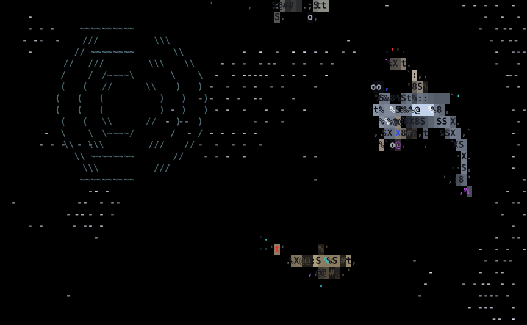

# sharks

[English](README.md) | **繁體中文**

讓 ASCII 鯊魚在你的終端機裡獵捕魚群，24-bit 全彩。這是 [stackedlol/ascii-sharks](https://github.com/stackedlol/ascii-sharks) 的 Rust 移植版，執行檔約 400 KB，不依賴任何套件，可以用滑鼠互動。

<p align="center">
  
</p>

<sub>這是程式實際渲染出的畫面，匯出成 SVG。右邊是無溝雙髻鯊，下方是虎鯊，左邊是點擊產生的漣漪。</sub>

## 特色

- **8 種鯊魚**，各有不同的輪廓、鰭和斑紋：兩種雙髻鯊、虎鯊、尖吻鯖鯊、長尾鯊、鉸口鯊、豹紋鯊，以及經典的真鯊。
- **每次執行都不一樣**。預設會隨機挑選不同種類的鯊魚，每隻的大小也各不相同。
- **會動的魚群**。數百條魚依照群體行為（boids）成群游動。驚慌會在魚群中傳開，逃跑的魚會往鯊魚路徑的兩側散開。鯊魚專挑落單的魚下手，被吃掉的魚之後會組成新的魚群游回來。
- **滑鼠互動**。移動滑鼠會驚動魚群。點一下會泛起漣漪：魚群四散，附近的鯊魚會轉身逃開，幾秒內不再獵食。
- **低資源用量**。記憶體約 2 MB，30 FPS 時約佔單核 CPU 的 6～8%，10 FPS 時約 3%。
- 支援螢幕保護模式、暫停、即時調整視窗大小，訊息有中英文。

## 安裝

### Homebrew（macOS、Linux）

```sh
brew install anson1eechun/tap/sharks
```

### npm

```sh
npm install -g ascii-sharks-term
# 或不安裝直接試跑：
npx ascii-sharks-term
```

套件裡附有預先編譯好的原生執行檔。啟動時，一個很小的 shell 腳本會用 `exec` 切換到對應平台的執行檔，所以背後不會留著 Node.js 行程。

### Cargo

```sh
cargo install --locked --git https://github.com/anson1eechun/ascii-sharks-term sharks
```

### 直接下載執行檔

到 [Releases](https://github.com/anson1eechun/ascii-sharks-term/releases) 下載對應平台的 `.tar.gz`，把 `sharks` 放進 `PATH`。在 macOS 上用瀏覽器下載的執行檔會被系統隔離，第一次執行前要先跑一次 `xattr -d com.apple.quarantine sharks`。

**支援平台：** macOS（Apple Silicon、Intel）和 Linux（x86_64、arm64，musl 靜態編譯）。Windows 請用 WSL。

## 使用方式

```sh
sharks                             # 隨機 4 種鯊魚
sharks -n 8                        # 隨機 8 隻鯊魚
sharks -k greathammer,tiger,mako   # 自己挑種類（sharks -l 可以看清單）
sharks -S                          # 螢幕保護模式，按任意鍵離開
sharks -f 20                       # 降低每秒畫面數，更省 CPU
```

| 選項 | |
|---|---|
| `-k, --sharks <種類,...>` | 指定要放哪些鯊魚，例如 `tiger,mako,zebra`。同一種可以重複。 |
| `-n, --count <n>` | 隨機鯊魚的數量，1～12，預設 4。有 `-k` 時不使用。 |
| `-l, --list` | 列出所有鯊魚種類。 |
| `-f, --fps <n>` | 每秒畫面數，1～120，預設 30。 |
| `-S, --screensaver` | 按任意鍵離開。 |
| `--aspect <n>` | 字元格的高寬比，自動偵測的結果看起來不對時才需要設定。 |
| `-V, --version` / `-h, --help` | |

| 執行中 | |
|---|---|
| `q`、`Esc`、`Ctrl-C` | 離開。 |
| `p` | 暫停。 |
| 移動滑鼠 | 魚群會避開游標。 |
| 點擊 | 泛起漣漪：魚群四散，附近的鯊魚逃開。 |

每隻鯊魚的大小是隨機的，介於最大那隻的 55%～100%。原作把大小也當成深度，所以比較小的鯊魚會游在比較深、比較暗的地方。想要原作的樣子，可以用 `sharks -k classic,classic,classic,classic`。

終端機需要支援 24-bit 全彩和滑鼠回報，例如 Ghostty、iTerm2、WezTerm、kitty、Alacritty。全螢幕效果最好。

### 鯊魚種類

| `-k` 代號 | 鯊魚 |
|---|---|
| `classic` | 經典真鯊，冷調藍灰色 |
| `hammerhead` | 錘頭雙髻鯊：頭翼往後掠，古銅橄欖色 |
| `greathammer` | 無溝雙髻鯊：頭翼又寬又直，中間有缺口，背鰭高聳 |
| `tiger` | 虎鯊：吻部方鈍，背上有條紋 |
| `mako` | 尖吻鯖鯊：圓錐形尖吻，魚雷般的身形，金屬靛藍色 |
| `thresher` | 長尾鯊：尾巴像一條和身體一樣長的鞭子 |
| `nurse` | 鉸口鯊：頭部寬闊，槳狀胸鰭，黃褐色 |
| `zebra` | 豹紋鯊：滿身斑點，尾巴像一條長緞帶 |

### 語言

訊息語言跟著系統語系（`LC_ALL`、`LC_MESSAGES`、`LANG`）。想自己指定的話，設定 `SHARKS_LANG=zh-TW` 或 `SHARKS_LANG=en`。

macOS 的終端機常常把 `LANG` 設成 `en_US.UTF-8`，所以就算系統是中文，也可能顯示英文。想維持中文，可以在 `~/.zshrc` 加一行 `export SHARKS_LANG=zh-TW`。

## 跟原作有多一致？

模擬（`world.ts`）和渲染（`renderer.ts`）都是逐句移植的。原作用 `Float32Array` 的地方，移植版也用 `f32`，兩邊也可以用同一個亂數產生器驅動。[`verify/verify.sh`](verify/verify.sh) 用同一個種子分別跑原作的 TypeScript 和 Rust 版，逐格比對 34 個畫面的字元、前景色和背景色，其中一半會強制觸發進食和重生。結果 34 個畫面完全一致。

大約 2 秒後，兩邊的結果會開始分歧。這是預期中的現象：兩邊數學函式庫的最後一個位元不同（約 1e-16），混沌的魚群模擬會把這個差異放大。

跟原作的差異：

- **沒有格線**。終端機沒辦法在字元之間畫線。原作本來就關掉的背景閃爍點也沒有移植。
- **加速但不改變結果的優化**。繪製鯊魚時，會跳過已經能證明碰不到的脊椎段和格子。這些優化依賴的形狀上限有單元測試把關。
- **新功能：點擊漣漪，以及鯊魚會躲開漣漪**。原作的 splash 沒有改動。沒有點擊時，新程式完全不會執行，所以上面的比對結果仍然成立。

## 效能

在 Apple Silicon 上量測，終端機大小 200×55，4 隻鯊魚、340 條魚：

| | CPU（單核） | 記憶體 |
|---|---|---|
| `sharks -f 10` | 3.1% | 2.3 MB |
| `sharks -f 20` | 6.2% | 2.3 MB |
| `sharks`（30 FPS） | 6～8% | 2.3 MB |
| `sharks -f 60` | 12.7% | 2.3 MB |
| 對照：cmatrix | 4% | 2 MB |
| 對照：asciiquarium | 5% | 11 MB |

大部分的成本來自原作本身的運算：魚群模擬，以及鯊魚的反鋸齒繪製（每格 5 個取樣點）。

## 開發

```sh
git clone --recurse-submodules https://github.com/anson1eechun/ascii-sharks-term
cd ascii-sharks-term/rs
cargo test --release           # 單元測試
cargo run --release            # 試跑
../verify/verify.sh            # 跟原作逐格比對（需要 Bun）
```

| 路徑 | |
|---|---|
| `rs/src/world.rs`、`renderer.rs`、`math.rs`、`species.rs` | 移植自原作對應的 `.ts` 檔 |
| `rs/src/term.rs` | 只用 libc 的終端機 I/O：raw mode、視窗大小、訊號、輸入，以及只重畫變動格子的 24-bit ANSI 輸出 |
| `rs/src/main.rs` | 參數、主迴圈、鍵盤和滑鼠，取代原作的 `engine.ts` |
| `upstream/` | 原作的 git submodule，固定在驗證過的版本 |
| `cell-canvas.ts` | 取代瀏覽器 canvas，讓 `verify/` 能在終端機尺寸的網格上執行原作的渲染器 |
| `npm/` | npm 套件的啟動腳本和設定檔 |

**發佈新版本是全自動的**。改 `rs/Cargo.toml` 的版本號並 commit，再推上對應的標籤：

```sh
git tag v0.3.0 && git push origin v0.3.0
```

接著 [Release 流程](.github/workflows/release.yml) 會：

1. 編譯 macOS 和 Linux 的執行檔
2. 建立 GitHub Release
3. 透過 [Trusted Publishing](https://docs.npmjs.com/trusted-publishers) 發佈到 npm。不需要 token，套件會附上來源證明（provenance）。
4. 用只能寫入 [anson1eechun/homebrew-tap](https://github.com/anson1eechun/homebrew-tap) 的 deploy key 推送 Homebrew formula。金鑰存放在 Secret `HOMEBREW_TAP_DEPLOY_KEY`。

每個步驟都可以安全地重跑，已經發佈的部分會自動跳過。必要時，也可以用 `scripts/publish.sh vX.Y.Z` 手動完成第 3、4 步。

**原作更新時**。更新 submodule，把 `upstream/src` 的改動移植到 `rs/src`，再跑 `verify/verify.sh`，必須是 0 mismatched。

## 致謝

模擬、鯊魚的造型和整體視覺都來自 drewdi 的 [ascii-sharks](https://github.com/stackedlol/ascii-sharks)，以 MIT 授權釋出。這個專案把它搬到終端機上。

## 授權

[MIT](LICENSE)：可以自由使用、修改、散布，包括商業用途。使用時請保留版權聲明，其中也包含原作者的版權聲明。
